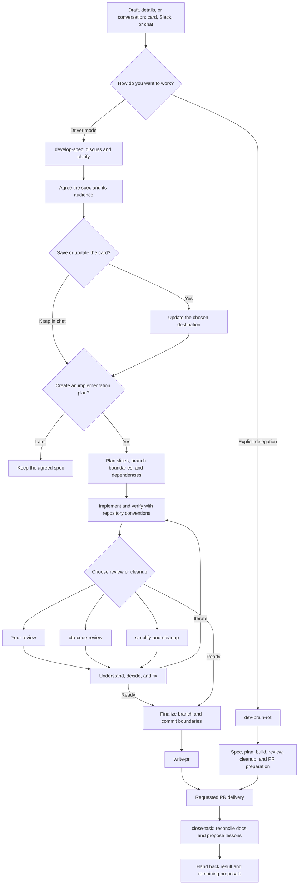

# Keep your brain in the loop

AI can write the code. **You're still responsible for what ships.**

These are the skills I use to turn a rough idea into reviewed, understandable
software. Usually I want to think through the decisions myself, with an agent
that helps me see the options. Sometimes I deliberately hand over more of the
work. Both are valid choices. The delegation should be yours.

## Choose how you work

|                 | Driver mode                                                                         | `dev-brain-rot`                                                                                            |
|-----------------|-------------------------------------------------------------------------------------|------------------------------------------------------------------------------------------------------------|
| You bring       | A draft, a problem, or a task to work through                                       | A goal and a place to build it                                                                             |
| Decisions       | You own consequential choices; the agent researches and recommends                  | You explicitly delegate routine choices and coordination                                                   |
| Missing context | The agent asks for intent it cannot retrieve                                        | The agent makes reasonable choices within scope; asks when the goal or a consequential boundary is missing |
| Pace            | Discuss, understand, decide, then continue                                          | Spec, plan, build, review, cleanup, PR preparation, and closure flow together                                 |
| Review          | Choose your own review, agent review, cleanup, or a combination                     | The agent coordinates review and resolves supported findings within the delegated scope                    |
| Closure         | Choose which specs and docs to update; select any proposed instruction improvements | Reconcile the task's known docs; propose instruction improvements for your selection                       |
| Responsibility  | Yours                                                                               | Still yours                                                                                                |

Both modes work for developers and nontechnical teammates. Driver mode does not
require a technical quiz, and delegated mode does not require pretending to know
every implementation detail.

## Driver mode: stay involved

Start with a rough draft, a few details, a pasted conversation, or an accessible
Slack thread. A task does not need an existing Notion card.

1. **Discuss with `develop-spec`.** Clarify the problem through a conversation.
   The agent brings facts, options, and recommendations. When intent or a material
   tradeoff is missing, it asks you instead of silently deciding.
2. **Agree and save the spec.** The agent offers to update your chosen card and
   establishes its audience: a personal/technical working task, a product brief,
   or two linked versions. Clear destination context can establish the audience;
   ambiguity brings a question.
3. **Choose whether to plan.** Once the spec is settled, the agent asks whether
   you want an implementation plan. The plan defines useful slices, validation,
   branch/PR boundaries, dependencies, and commit preferences.
4. **Implement and understand.** Use the repository's implementation guidance.
   Work in slices, inspect the result, ask for explanations, and iterate until
   you are satisfied. An agreed spec or plan is not an automatic instruction to
   start coding.
5. **Choose review and cleanup.** Review it yourself, use `cto-code-review`,
   run `simplify-and-cleanup`, or combine them. CTO review lets you accept,
   reject, or defer findings, then choose fixes here, a subagent, a handoff
   prompt, or fixing them yourself.
6. **Prepare delivery.** Revisit branch boundaries if implementation changed the
   plan and use `write-pr` for concise PR wording.
7. **Close the task with `close-task`.** Choose the specs and relevant docs to
   update, with a shortlist suggested from the task when useful. Reconcile them
   with the actual result and consider concrete lessons. Changes to shared
   skills or steering instructions remain your choice.

Use only the piece you need. `develop-spec` can discuss one decision, turn a Slack
thread into a product task, rewrite a technical spec, or plan an already agreed
change. It does not restart the full workflow for each of those requests.

```text
Use $develop-spec to talk through this draft: <card or idea>.
I want to understand the choices and stay in the driver's seat.
```

A short brief is not permission to invent your product decisions. You can
explicitly delegate an individual choice with “you decide” or “go automatically”
without handing over the entire workflow.

```text
Use $develop-spec to draft a product task from this Slack thread: <link>.
Only write the draft; flag any important unresolved decisions.

Use $close-task to wrap up this work. Help me choose which specs and docs
to update, then propose useful improvements from the session.
```

## Dev Brain Rot: deliberately hand over the wheel

For a nontechnical teammate, a familiar task, or a day when you want to delegate,
invoke `dev-brain-rot` explicitly. It coordinates the companion skills and the
repository's implementation conventions from spec through PR preparation and
task closure.

It records the plan and meaningful decisions, implements and verifies the work,
coordinates review and fixes, simplifies the result, prepares the requested
delivery, then reconciles the task's known documentation. It proposes lessons
without silently changing shared skills or steering instructions. You get an understandable
result, useful evidence, and anything that still needs your decision.

```text
Use $dev-brain-rot to implement <goal or card> in <repository>.
Choose routine implementation details and open a PR when ready.
```

This mode is explicit-only. It does not activate because you gave a short prompt
or because you are not a developer. It can still need a real goal, access, or a
decision outside the delegated scope. You can take the wheel back at any time.

## Quality over quantity

Choose the simplest complete solution: reuse existing capabilities, keep types
and contracts precise, and prove behavior with meaningful tests. Abstractions,
defensive machinery, and comments should earn their place. Repository-specific
guidance determines the stack and checks. These standards apply while building;
cleanup is a final pass, not the first time quality matters.

The automatic
workflow's [implementation quality reference](skills/dev-brain-rot/references/implementation-quality.md)
makes that baseline explicit without requiring a personal or company-specific
development skill.

## The workflow

This is the full route.



## The skills

| Skill                                                        | Reach for it when                                                                                      |
|--------------------------------------------------------------|--------------------------------------------------------------------------------------------------------|
| [develop-spec](skills/develop-spec/SKILL.md)                 | You want to think through a change and write the right spec for its audience.                          |
| [cto-code-review](skills/cto-code-review/SKILL.md)           | You want evidence-based scrutiny of correctness, security, performance, and structural simplicity.     |
| [simplify-and-cleanup](skills/simplify-and-cleanup/SKILL.md) | You want less complexity and boilerplate, plus a useful check of delivery boundaries.                  |
| [write-pr](skills/write-pr/SKILL.md)                         | You want the outcome and essential reviewer context, with implementation bookkeeping left in the diff. |
| [dev-brain-rot](skills/dev-brain-rot/SKILL.md)               | You explicitly want the whole workflow coordinated for you.                                            |
| [close-task](skills/close-task/SKILL.md)                     | You want to reconcile specs and docs, then choose useful improvements from what happened.              |

## Install

Install the collection with the [Skills CLI](https://skills.sh/docs):

```sh
npx skills add GigiLoria5/agent-skills
```

Install the collection to give `dev-brain-rot` its companion skills. For an
individual tool:

```sh
npx skills add GigiLoria5/agent-skills --skill write-pr
```

Each skill is a portable `SKILL.md` directory. Codex metadata lives in
`agents/openai.yaml`. Available tools, repository access, and host permissions
determine which actions can actually run.

## Author & Inspiration

This is my authored collection. [PROVENANCE.md](PROVENANCE.md) records origins
and inspiration; third-party downloads stay with their original sources.

This workflow draws inspiration from:

- [Addy Osmani's agent-skills](https://github.com/addyosmani/agent-skills)
- [Matt Pocock's skills](https://github.com/mattpocock/skills)
- [obra/superpowers](https://github.com/obra/superpowers)

Improve instructions from real use: what decision did the agent get wrong, and
what small change would help it get that decision right next time?

[MIT license](LICENSE)
