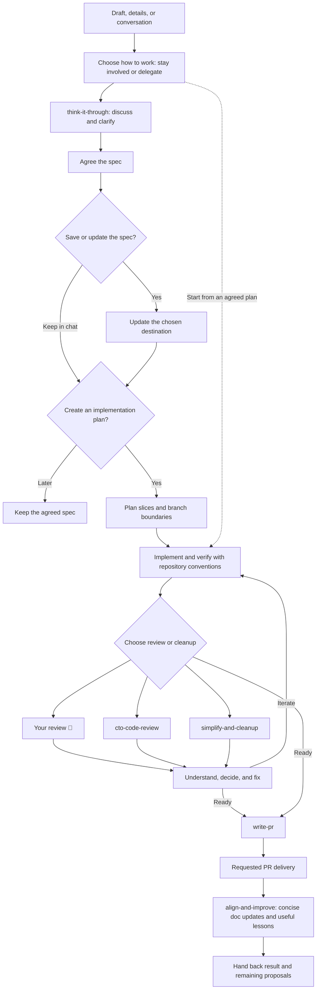

# Keep your brain in the loop

AI can write the code. **You're still responsible for what ships.**

These are the skills I use to turn a rough idea into reviewed, understandable
software. Usually I want to think through the decisions myself, with an agent
that helps me see the options. Sometimes I deliberately hand over more of the
work. Both are valid choices. The delegation should be yours.

## Contents

- [Install](#install)
- [Choose how you work](#choose-how-you-work)
- [Driver mode: stay involved](#driver-mode-stay-involved)
- [Make It Happen: deliberately delegate](#make-it-happen-deliberately-delegate)
- [The workflow](#the-workflow)
- [The skills](#the-skills)
- [Author & inspiration](#author--inspiration)

## Install

Install all six skills for **Claude Code and Codex**, available across projects:

```sh
npx skills add GigiLoria5/agent-skills -g -a claude-code -a codex --skill '*'
```

Replace `'*'` with a skill name such as `write-pr` to install just that skill.
Omit `-g` for a project-local installation. Install the full collection when using
`make-it-happen`, so its companion skills are available.

Use `$think-it-through` in Codex or `/think-it-through` in Claude Code. The examples
below
use Codex's syntax. See
the [Skills CLI reference](https://github.com/vercel-labs/skills/blob/main/docs/commands.md)
for other agents and options.

## Choose how you work

|                 | Driver mode                                                                         | `make-it-happen`                                                                                           |
|-----------------|-------------------------------------------------------------------------------------|------------------------------------------------------------------------------------------------------------|
| You bring       | A draft, a problem, or a task to work through                                       | A goal and a place to build it                                                                             |
| Decisions       | You own consequential choices; the agent researches and recommends                  | You explicitly delegate routine choices and coordination                                                   |
| Missing context | The agent asks for intent it cannot retrieve                                        | The agent makes reasonable choices within scope; asks when the goal or a consequential boundary is missing |
| Pace            | Discuss, understand, decide, then continue                                          | Coordinate the requested phases, or the whole workflow                                                     |
| Review          | Choose your own review, agent review, cleanup, or a combination                     | The agent coordinates review and resolves supported findings within the delegated scope                    |
| Closure         | Choose which specs and docs to update; select any proposed instruction improvements | Reconcile the task's known docs; propose instruction improvements for your selection                       |
| Responsibility  | Yours                                                                               | Still yours                                                                                                |

Both modes work for developers and nontechnical teammates. Driver mode does not
require a technical quiz, and delegated mode does not require pretending to know
every implementation detail.

Choose the mode for each piece, not once for the whole task. Think through the
spec and plan in driver mode, delegate implementation with `make-it-happen`, then
review the result yourself. You can switch back at any point; settled decisions
carry forward and delegation stays within the phases you requested.

In either mode, aim for the simplest complete solution. Reuse what exists, keep
types and contracts precise, and verify behavior with meaningful tests and checks.
Repository guidance determines the stack and conventions. Quality is part of
each implementation slice; cleanup helps remove what is still unnecessary.
The [implementation quality reference](skills/make-it-happen/references/implementation-quality.md)
sets out the baseline used by the delegated workflow.

## Driver mode: stay involved

Start with a rough draft, a few details, a pasted conversation, or an accessible
Slack thread. A task does not need an existing Notion card.

`think-it-through` and `make-it-happen` work best with connected context: use MCP
integrations for Notion, Slack, or your task tracker so the agent can read sources
and update the destination you choose. Connections are optional; pasted notes,
conversations, and local Markdown work too. Access to a tool does not choose what
the agent should update.

1. **Discuss with `think-it-through`.** Clarify the problem through a conversation.
   The agent brings facts, options, and recommendations. When intent or a material
   tradeoff is missing, it asks you instead of silently deciding.
2. **Agree and save the spec.** The agent offers to update your chosen card and
   establishes its audience: a personal/technical reference, a product brief,
   or two linked versions. Clear destination context can establish the audience;
   ambiguity brings a question.
3. **Choose whether to plan.** Once the spec is settled, the agent asks whether
   you want an implementation plan. The plan defines useful slices, validation,
   branch/PR boundaries, dependencies, and commit preferences. Keep it as ignored
   local Markdown in the repository, add it to the technical card, or use both.
   Local plans stay untracked unless you ask otherwise.
4. **Implement and understand.** Use the repository's implementation guidance.
   Work in slices, inspect the result, ask for explanations, and iterate until
   you are satisfied. An agreed spec or plan is not an automatic instruction to
   start coding.
5. **Choose review and cleanup.** Review it yourself, use `cto-code-review`,
   run `simplify-and-cleanup`, or combine them. CTO review lets you accept,
   reject, or defer findings, then choose fixes here, a subagent, a handoff
   prompt, or fixing them yourself.
6. **Prepare delivery.** Revisit branch boundaries if implementation changed the
   plan and use `write-pr` for concise PR wording.
7. **Align docs and improve with `align-and-improve`.** Choose the specs and relevant
   docs to
   update, with a shortlist suggested from the task when useful. Reconcile them
   with the actual result and consider concrete lessons. Changes to shared
   skills or steering instructions remain your choice.

Use only the piece you need. `think-it-through` can discuss one decision, turn a Slack
thread into a product task, rewrite a technical spec, or plan an already agreed
change. It does not restart the full workflow for each of those requests.

```text
Use $think-it-through to talk through this draft: <card or idea>.
I want to understand the choices and stay in the driver's seat.
```

A short brief is not permission to invent your product decisions. You can
explicitly delegate an individual choice with “you decide” or “go automatically”
without handing over the entire workflow.

```text
Use $think-it-through to draft a product task from this Slack thread: <link>.
Only write the draft; flag any important unresolved decisions.

Use $align-and-improve to wrap up this work. Help me choose which specs and docs
to update, then propose useful improvements from the session.
```

## Make It Happen: deliberately delegate

For a nontechnical teammate, a familiar task, or a day when you want to delegate,
invoke `make-it-happen` explicitly. It coordinates the companion skills and the
repository's implementation conventions for the phases you request, up to the
whole route from spec through PR delivery and documentation alignment.

It records the plan and meaningful decisions, implements and verifies the work,
coordinates review and fixes, simplifies the result, prepares the requested
delivery, then reconciles the task's known documentation when those phases are
included. It proposes lessons
without silently changing shared skills or steering instructions. You get an
understandable result, useful evidence, and anything that still needs your decision.

```text
Use $make-it-happen to implement <goal or card> in <repository>.
Choose routine implementation details and open a PR when ready.

Use $make-it-happen to implement the plan we just agreed.
Stop after implementation and verification; I'll review before we prepare PRs.
```

This mode is explicit-only. It does not activate because you gave a short prompt
or because you are not a developer. It can still need a real goal, access, or a
decision outside the delegated scope. You can take the wheel back at any time.

## The workflow

This is the full route. Enter at the piece you need, skip phases you did not
request, and choose driver or delegated mode for each piece. `write-pr` comes
before `align-and-improve`; final doc changes can update the existing PR.



## The skills

| Skill                                                        | Reach for it when                                                                                      |
|--------------------------------------------------------------|--------------------------------------------------------------------------------------------------------|
| [think-it-through](skills/think-it-through/SKILL.md)         | You want to think through a change and write the right spec for its audience.                          |
| [cto-code-review](skills/cto-code-review/SKILL.md)           | You want evidence-based scrutiny of correctness, security, performance, and structural simplicity.     |
| [simplify-and-cleanup](skills/simplify-and-cleanup/SKILL.md) | You want less complexity and boilerplate, plus a useful check of delivery boundaries.                  |
| [write-pr](skills/write-pr/SKILL.md)                         | You want the outcome and essential reviewer context, with implementation bookkeeping left in the diff. |
| [make-it-happen](skills/make-it-happen/SKILL.md)             | You explicitly delegate selected phases or the whole workflow.                                         |
| [align-and-improve](skills/align-and-improve/SKILL.md)       | You want to reconcile specs and docs, then choose useful improvements from what happened.              |

## Author & Inspiration

This is my authored collection. [PROVENANCE.md](PROVENANCE.md) records origins
and inspiration; third-party downloads stay with their original sources.

Improve instructions from real use: what decision did the agent get wrong, and
what small change would help it get that decision right next time?

[MIT license](LICENSE)
